**Contents**

- [1. Problem Summary](#1-problem-summary)
- [2. Acceptance Criteria](#2-acceptance-criteria)
  - [Public API](#public-api)
  - [Reads and Expiry](#reads-and-expiry)
  - [Invalidation](#invalidation)
  - [Failure Behavior](#failure-behavior)
  - [Caller Responsibilities](#caller-responsibilities)
- [3. Out of Scope](#3-out-of-scope)
- [4. Glossary](#4-glossary)
- [5. Design](#5-design)
  - [5.1 Cache Reader](#51-cache-reader)
  - [5.2 Cache Owner](#52-cache-owner)
  - [5.3 Shared-Cache Interface](#53-shared-cache-interface)
  - [5.4 Registration and Refresh Coordination](#54-registration-and-refresh-coordination)
  - [5.5 Expiry and Freshness](#55-expiry-and-freshness)
  - [5.6 Owner Invalidation](#56-owner-invalidation)
  - [5.7 Failure Handling](#57-failure-handling)
  - [5.8 Application Integration and Verification](#58-application-integration-and-verification)
- [6. Rejected Alternatives](#6-rejected-alternatives)
  - [Fetch From the Source for Every Operation](#fetch-from-the-source-for-every-operation)
  - [Use Only a Shared Cache](#use-only-a-shared-cache)
  - [Require Shared-Write Confirmation Before Returning](#require-shared-write-confirmation-before-returning)
  - [Cache Arbitrary Records or Query Results](#cache-arbitrary-records-or-query-results)
  - [Coordinate Loading and Invalidation Across All Instances](#coordinate-loading-and-invalidation-across-all-instances)

## 1. Problem Summary

Reference data provides shared definitions and lookup values used to interpret, validate, classify, or enrich other data. Examples include identifiers, codes, categories, labels, units, supported values, and relationships between them. It is typically read frequently and updated infrequently, although its values can change.

Reference data can be used throughout a system:

- **Database queries:** Joining descriptive attributes, resolving identifiers, filtering, sorting, and grouping records.
- **Application logic:** Validating inputs, interpreting codes, evaluating eligibility, and supplying lookup values to calculations or rules.
- **APIs:** Enriching responses, exposing supported values, and translating between internal and external representations.
- **Service consumers:** Providing common definitions to services, workers, scripts, and command-line tools.
- **User interfaces:** Populating controls, displaying labels, validating selections, and interpreting returned values.
- **Background processing:** Validating, normalizing, and enriching messages, imports, exports, and batch operations.
- **Search and read models:** Resolving attributes used to construct indexes, projections, and aggregated views.
- **Reporting and analytics:** Classifying records, grouping results, and presenting consistent descriptions.

A common access pattern acquires this data separately for each operation. Database queries repeatedly join against reference tables; servers materialize the results in memory and discard them after completing a request. Downstream consumers repeatedly fetch the same data from an endpoint, use it briefly, and discard their copies.

This ties the lifetime of reusable data to individual operations. Unchanged information repeatedly incurs query execution, network transfer, serialization, parsing, and memory allocation. Database buffering may reduce physical reads, but it does not eliminate repeated work across application boundaries.

As request volume and the number of consumers grow, this work grows with them—even when the reference data remains unchanged.

## 2. Acceptance Criteria

### Public API

- Provide a local-only reader with synchronous `register` and asynchronous `get`. An owner additionally accepts a shared-cache adapter and exposes asynchronous `invalidate`.
- Keep the shared-cache interface backend-independent: asynchronous reads with explicit hit/miss results, writes with expiry, and deletion. Require no particular backend, protocol, client library, or encoding.
- Register each domain under an exact, case-sensitive name with a caller-supplied, argument-free loader returning one complete dataset or lookup value.
- Registration performs no source loading or cache I/O. Reject duplicate names and invalid configuration without changing existing registrations or leaving partial registrations in the client or adapter.
- Reads and invalidations of unregistered domains reject with explicit errors.
- Resolve local policy from the domain override, then the client default. Resolve shared policy from the domain override, then the adapter default. Capture policies at registration so later configuration changes do not affect registered domains.
- Accept finite, nonnegative local lifetimes; zero means immediate expiry. Enforce the shared adapter’s lifetime constraints and reject owner registration when local lifetime exceeds shared lifetime.

### Reads and Expiry

- Retain values across operations within a client instance. A valid local hit performs no shared-cache access or source loading.
- On a local miss, an owner checks the shared cache and loads from the source only on a miss or read failure. A reader loads directly from its source.
- Concurrent misses for one domain share a refresh and its result or failure within the client instance. Different domains and clients remain independently loadable.
- A successful, nonsuperseded source refresh populates local memory. Owners also attempt shared population without awaiting asynchronous write confirmation; successful reads do not confirm shared persistence.
- Reject `null` or `undefined` loader results. Accept empty datasets and other falsy values; never infer cache misses from truthiness.
- Start local lifetime when a value is populated. Reads do not extend it, and an entry at or beyond its expiry boundary cannot satisfy a read.
- Shared-to-local promotion starts a full local lifetime without inheriting the shared entry’s remaining lifetime. Expiry governs cache reuse; it does not establish the age or freshness of source data.

### Invalidation

- Clear the invoking owner’s local value before shared deletion and again when that deletion settles.
- Each invalidation resolves after its own shared deletion succeeds or rejects with that deletion’s failure. Local clearing applies in either case, including overlapping invalidations.
- Detach subsequent reads from superseded refresh work. Earlier callers may receive its result, but superseded work must not initiate further cache population.
- Invalidation does not cancel dispatched operations or establish an atomic freshness barrier. Outstanding writes may complete afterward; failed deletion may allow an older shared value to be loaded again.
- Other clients retain their local values until expiry or their own invalidation. Shared storage alone provides neither invalidation broadcast nor distributed load coordination.

### Failure Behavior

- Propagate source-loading failures to waiting callers without caching failures or automatically retrying within the failed read. A later read can retry.
- Shared-read failures fall back to the source loader. Shared-write failures preserve an otherwise successful read and its local value.
- Report malformed shared representations, attempt deletion, and continue to the loader without awaiting cleanup. Background cleanup and population have no guaranteed completion order.
- Report each failed shared operation once, with its domain, operation, failure classification, and original error. Ordinary misses and source failures are not shared-cache errors. Contain exceptions and rejected promises from the reporting callback.
- Network-cache adapters apply configurable per-operation deadlines. Timeout stops waiting without guaranteeing cancellation; late outcomes must not produce unhandled failures.

### Caller Responsibilities

- Supply source-loader deadlines and cancellation where required. Network-operation deadlines do not bound source loading or the complete read.
- Treat locally retained objects as shared references: they are neither cloned nor frozen, and caller mutation can affect subsequent reads.
- Supply values compatible with the adapter’s declared encoding and round-trip transformations.
- Validate domain schemas where required. Declared result types and successful decoding do not establish runtime schema correctness.
- When replacing query-time enrichment, preserve record selection, cardinality, filtering, ordering, grouping, pagination, and response meaning.

## 3. Out of Scope

- **General-purpose query or response caching:** Caching arbitrary queries, request-specific results, or unbounded collections of individually keyed records.
- **Source-data management:** Owning source records, performing source writes, or automatically rewriting database queries and endpoints.
- **Distributed coordination:** Cross-process load suppression, invalidation broadcasts, globally synchronized cache state, or atomic invalidation across instances.
- **Proactive refresh:** Scheduled refresh, prewarming, and stale-while-revalidate.
- **Automatic capacity management:** Memory budgets, size-based eviction, and background removal of expired local entries.
- **Durable storage guarantees:** Using the cache as a system of record, guaranteeing shared-write persistence, or draining background writes during shutdown.
- **Infrastructure lifecycle:** Provisioning network-cache services or managing their connections, credentials, reconnection, and shutdown.
- **Application security policy:** Resolving tenant identity, authorizing data access, or automatically constructing isolation boundaries.

## 4. Glossary

| Term                      | Meaning                                                                                                                                     |
| ------------------------- | ------------------------------------------------------------------------------------------------------------------------------------------- |
| **Reference data**        | Shared definitions or lookup values used to interpret, validate, classify, or enrich other data.                                            |
| **Domain**                | One named dataset or lookup value treated as a unit of loading, caching, and invalidation.                                                  |
| **Authoritative source**  | The system responsible for maintaining the underlying data.                                                                                 |
| **Loader**                | A caller-supplied operation that retrieves a complete domain value. It may access the authoritative source directly or through an endpoint. |
| **Reader**                | A client that retains values in local memory and invokes its loader on a miss.                                                              |
| **Owner**                 | A client that also reads, populates, and invalidates a shared cache. This role does not imply ownership of the underlying data.             |
| **Local cache**           | Values retained in memory by one client instance.                                                                                           |
| **Shared cache**          | Storage through which multiple clients or processes can reuse cached values, typically over a network.                                      |
| **Cache adapter**         | An implementation of the shared-cache interface for a particular storage backend.                                                           |
| **Hit / miss**            | Whether a cache read finds a usable entry. An expired local entry is a miss.                                                                |
| **Time to live (TTL)**    | The configured lifetime of a cached entry before expiry.                                                                                    |
| **Population**            | Storing a value in a cache.                                                                                                                 |
| **Promotion**             | Populating local memory with a value retrieved from the shared cache.                                                                       |
| **Refresh**               | The work initiated by a local miss to obtain a value from the shared cache or loader.                                                       |
| **Single-flight loading** | Sharing one in-progress refresh among concurrent callers for the same domain within a client instance.                                      |
| **Invalidation**          | Clearing cached data for a domain.                                                                                                          |
| **Superseded refresh**    | In-progress refresh work that invalidation has made ineligible to populate caches.                                                          |
| **Best-effort write**     | A shared-cache write whose success is not required for the read to succeed.                                                                 |
| **Operation deadline**    | The point after which the caller stops waiting for an operation.                                                                            |
| **Encoding**              | Conversion between application values and a representation supported by a cache backend.                                                    |

## 5. Design

### 5.1 Cache Reader

A cache reader retains reference data in process memory. Applications create it once, register the domains they need, and reuse it across requests.

Each domain has a loader that retrieves its complete value. The loader may query a database, call an endpoint, or use another application-defined source.



Local hits avoid the source entirely. Concurrent misses share the pending refresh, including its result or failure. Expired entries are replenished on demand.

### 5.2 Cache Owner

A cache owner extends local reuse with access to a shared cache. On a local miss, it checks shared storage before invoking its loader.


A shared hit avoids source loading. A successful source load becomes available locally before asynchronous shared-write confirmation.

The owner also exposes invalidation. It clears its local value and requests shared deletion; it does not control other processes’ local memory. The concurrency boundaries are described in §5.6.

The diagrams show successful value-return paths. Cache population is subject to the generation checks described below, and failures follow §5.7.

### 5.3 Shared-Cache Interface

The owner depends on a cache adapter rather than a particular storage product.

| Capability           | Contract                                                                            |
| -------------------- | ----------------------------------------------------------------------------------- |
| Policy configuration | Supply defaults and validate domain registration synchronously without network I/O. |
| Read                 | Return an explicit miss or a hit containing a decoded value.                        |
| Write                | Store a value with its registered lifetime.                                         |
| Delete               | Remove the stored value; absence is successful deletion.                            |

The adapter owns backend key construction, encoding, decoding, and network-operation deadlines. The application owns connection creation, credentials, reconnection, and shutdown.

Encoding must support the domain’s values. Applications requiring equivalent results from source loads and shared hits account for declared transformations of runtime types. The cache core does not prescribe JSON or perform domain-schema validation.

Applications sharing backend storage must agree on the meaning and representation of a domain name. Values differing by environment, tenant, or representation version require distinct domain names or adapter namespaces.

### 5.4 Registration and Refresh Coordination

Registration resolves and captures policies before making a domain available. An owner also registers the shared policy with its adapter. Failed validation leaves no partial registration.

Each client maintains the following state per domain:

| State              | Purpose                                                       |
| ------------------ | ------------------------------------------------------------- |
| Name and loader    | Identify the value and acquire it from its configured source. |
| Effective policies | Determine local and shared lifetimes.                         |
| Local entry        | Retain the value and its expiry time.                         |
| In-flight refresh  | Coordinate concurrent callers.                                |
| Generation         | Identify refresh work superseded by invalidation.             |

On a local miss, the client publishes a refresh task before invoking external work. Further callers join that task instead of starting another.

The refresh captures its starting generation. Before populating local memory or initiating shared population, it checks that the generation remains current. This prevents invalidated work from restoring cache entries after it finishes.

After a shared miss or failure, the owner rechecks local memory before invoking the loader. Another eligible refresh may have filled it while the shared read was pending.

When a refresh settles, it clears the in-flight reference only if that reference still identifies its own task. An older refresh therefore cannot remove coordination for newer work.

This coordination is per domain and client instance. Independently cold processes can still load the same domain simultaneously.

### 5.5 Expiry and Freshness

Local entries use fixed expiry:

```
expiresAt = populationTime + localLifetime
```

An entry is usable only while the current time is earlier than `expiresAt`. Reads do not change that boundary.

Promotion from shared storage starts a new local lifetime without inspecting the shared entry’s remaining lifetime. Requiring local lifetime not to exceed shared lifetime validates the configured policies; it does not bound the age of the underlying data.

Layered consumers can extend reuse further. A reader may retain a value obtained near the end of the serving owner’s local lifetime. Applications select policies according to acceptable end-to-end staleness, including upstream caching.

Expiry is checked on access and does not schedule memory reclamation. Whole-domain loading therefore suits bounded datasets whose retained size is acceptable in each consuming process.

### 5.6 Owner Invalidation

Invalidation follows three steps:

1. Advance the domain’s generation, clear its local entry, and detach its in-flight refresh.
2. Request shared deletion.
3. When deletion settles, advance the generation and clear local state again, regardless of success or failure.

The first clearing prevents later reads from joining pre-invalidation work. The second discards local values refilled while shared deletion was pending.

Earlier callers may still receive a superseded refresh’s result. Its generation check prevents new cache population, but cannot retract a shared write already dispatched.

Other clients retain their local entries. A failed shared deletion can also leave an older value available for later promotion. Invalidation therefore establishes neither global removal nor an atomic transition to fresh data.

Applications update the authoritative source before requesting invalidation and handle deletion failure according to their freshness requirements. Each overlapping invalidation reports the outcome of its own shared deletion.

### 5.7 Failure Handling

| Failure                                              | Handling                                                                           |
| ---------------------------------------------------- | ---------------------------------------------------------------------------------- |
| Loader throws, rejects, or returns an invalid result | Reject waiting callers, retain no failure entry, and release refresh coordination. |
| Shared read fails or exceeds its deadline            | Report the failure and continue to the loader.                                     |
| Shared representation cannot be decoded              | Report the failure, dispatch best-effort deletion, and continue loading.           |
| Shared write fails                                   | Report the failure while preserving the successful read and local entry.           |
| Explicit shared deletion fails                       | Report and reject invalidation while retaining local-clearing behavior.            |
| Error-reporting callback throws or rejects           | Contain the reporting failure without changing the operation’s outcome.            |

Failure events identify the domain, operation, classification, and original error. Emit them per failed operation rather than per caller sharing that operation.

Adapter deadlines stop waiting without guaranteeing cancellation. Late completion or rejection must be handled safely. Source-loader deadlines remain with the caller; synchronous encoding work is outside a network-operation deadline.

Background corrupt-entry deletion can race with subsequent population and remove a replacement value. This produces another miss rather than a shared-retention guarantee.

### 5.8 Application Integration and Verification

For query enrichment, select the required records and reference identifiers, obtain the domain once, and resolve attributes in memory. Reuse that value throughout the operation.

Review each join before replacing it. A join may enforce existence, filtering, ordering, grouping, or pagination rather than merely attach attributes. Preserve those semantics in SQL or an explicitly equivalent operation. Cached attributes must not silently become authoritative inputs to decisions requiring current source data.

For endpoint consumers, put the endpoint call behind a reusable reader’s loader. The serving endpoint can use an owner whose loader queries the authoritative source. This reduces endpoint traffic at the consumer boundary and source queries at the serving boundary.

Introduce the integration one domain at a time. Compare results against the existing path, including missing references, empty datasets, duplicate relationships, and page boundaries. Exercise concurrent misses and controlled invalidation races.

Measure source-loader calls, endpoint calls, refresh latency, shared failures, and retained memory under cold, warm, and expired conditions. These measurements establish whether the integration removes repeated acquisition without changing behavior; no performance improvement is assumed before measurement.

## 6. Rejected Alternatives

### Fetch From the Source for Every Operation

Direct queries and endpoint calls avoid cache-coherence concerns but repeat acquisition even when the data has not changed. Database buffering does not eliminate application-side transfer, decoding, and allocation.

This remains appropriate for data requiring authoritative reads, but does not address the reuse problem targeted by this design.

### Use Only a Shared Cache

A shared cache can reduce source queries, but accessing it for every operation retains network, encoding, and availability costs.

Local retention removes those calls during an entry’s lifetime. The accepted trade-off is duplicated process memory and temporary disagreement between instances.

### Require Shared-Write Confirmation Before Returning

Awaiting shared population would make successful reads depend on another network operation after the source has already supplied a usable value. A cache-write failure could delay or reject work that otherwise succeeded.

Best-effort population preserves read availability, accepting that another instance may miss the shared value and load it again.

### Cache Arbitrary Records or Query Results

A general-purpose keyed cache supports large datasets and selective retrieval, but introduces key-cardinality management, per-record loading, query identity, and more granular invalidation.

Named whole-domain values keep acquisition and policy boundaries explicit for bounded reference datasets. Large or highly selective datasets require a different caching model.

### Coordinate Loading and Invalidation Across All Instances

Distributed locks, invalidation broadcasts, and version-coordination protocols can reduce duplicate loading or improve cross-process freshness. They also introduce coordination failure modes and additional operational dependencies.

This design accepts independent local lifetimes and occasional duplicate loads. Stronger coordination becomes necessary if globally synchronized freshness or cross-process load suppression becomes an acceptance criterion.